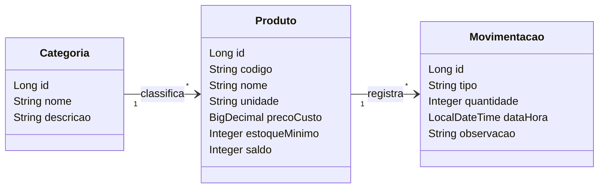
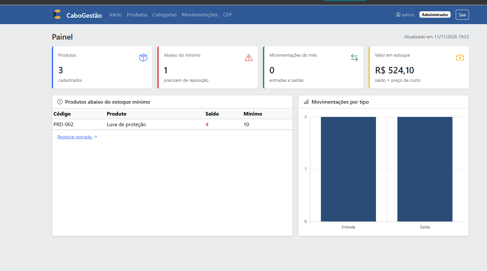
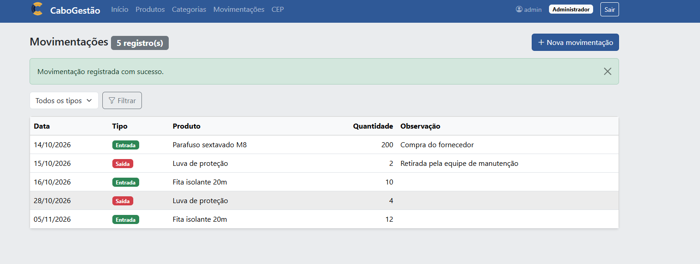
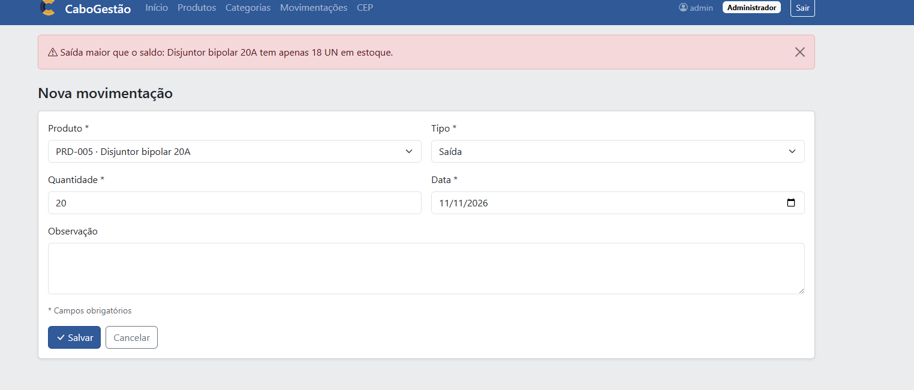
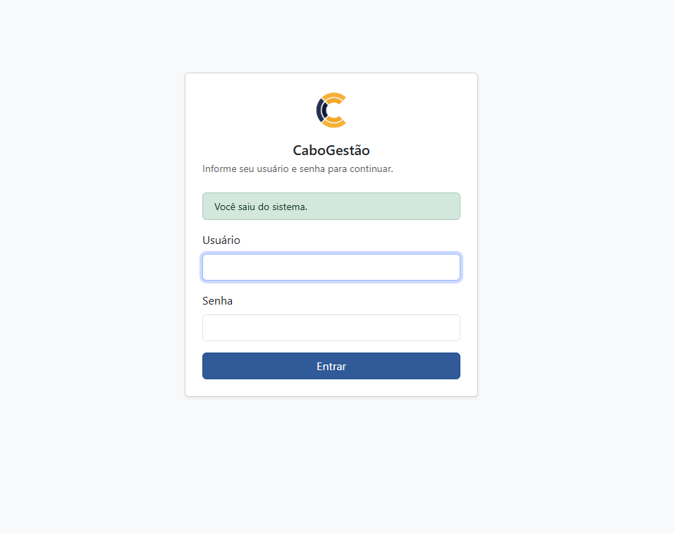

# CaboGestão 


| | |
|---|---|
| **Aluno(a)** | Eduardo Massi |
| **Turma** |TEC-N-001788/2026 |
| **Opção escolhida** | Controle de Estoque |
| **Versão atual** | 1.0.0 |

---

## 1. Visão geral

### 1.1 Problema
<!-- Que problema o sistema resolve? Quem sofre com esse problema hoje e como ele é resolvido (planilha, papel, WhatsApp...)? 3 a 5 linhas. -->O sistema busca resolver o problema da desorganização no controle de estoque, que pode dificultar o acompanhamento dos produtos disponíveis. Atualmente, esse controle pode ser realizado de forma manual, por meio de anotações, planilhas ou outros métodos pouco centralizados. Isso pode causar erros na quantidade registrada, perda de informações e dificuldade para identificar produtos que precisam ser repostos. O sistema pretende centralizar e facilitar o gerenciamento dessas informações.

### 1.2 Canvas do projeto

| Bloco | Resposta |
|---|---|
| **Usuários** (quem usa o sistema) |Funcionários responsáveis pelo estoque e gestores do estabelecimento. |
| **Problema** (dor atual) | Desorganização no controle de produtos, dificuldade para saber as quantidades disponíveis e risco de falta ou excesso de estoque.|
| **Proposta de valor** (o que melhora com o sistema) |Centralizar o controle do estoque, facilitando o cadastro, a consulta e a atualização dos produtos e permitindo acompanhar melhor a situação do estoque. |
| **Funcionalidades principais** | 	Cadastrar, editar, excluir e consultar produtos; registrar entradas e saídas de produtos; controlar quantidades em estoque; pesquisar produtos; identificar produtos com estoque baixo.|
| **Informações que o sistema guarda** |	Produtos, código, nome, descrição, categoria, quantidade em estoque, estoque mínimo, preço e registros de entradas e saídas. |
| **Indicadores** (o que o gestor quer acompanhar) |	Quantidade total de produtos, produtos com estoque baixo, produtos sem estoque, entradas e saídas de produtos e valor estimado do estoque. |
| **Restrições** (prazo, tecnologia, equipe) | Projeto individual · Java 21 · Spring Boot 4 · entrega v1.0 em 11/11 |

---

## 2. Requisitos

### 2.1 Requisitos funcionais (o que o sistema FAZ)

| ID | Requisito | Nível |
|---|---|---|
| RF01 |O sistema deve permitir pesquisar produtos e identificar aqueles com estoque baixo. | Essencial |
| RF02 |O sistema deve permitir cadastrar, listar, editar e excluir produtos. |Essencial |
| RF03 |O sistema deve permitir registrar entradas e saídas de produtos do estoque. |Essencial |
| RF04 |O sistema deve permitir visualizar o histórico de entradas e saídas de cada produto, informando a data, a quantidade e o tipo de movimentação.|Essencial |

### 2.2 Requisitos não funcionais (COMO o sistema deve ser)

| ID | Requisito |
|---|---|
| RNF01 | O sistema deve ser acessado pelo navegador (aplicação web). |
| RNF02 | O sistema deve exigir login e senha; as senhas devem ser armazenadas criptografadas. |
| RNF03 |O sistema deve possuir uma interface simples e fácil de utilizar. |

### 2.3 Regras de negócio (as REGRAS do negócio que o sistema precisa respeitar)

| ID | Regra |
|---|---|
| RN01 |  Não é permitido registrar uma saída maior que o saldo do produto. |
| RN02 |Todo produto deve possuir nome, código e quantidade inicial válida. |

---

## 3. Histórias de usuário

Formato: **Como** *[papel]*, **quero** *[ação]*, **para** *[benefício]*.

**HU01 —** Como funcionário responsável pelo estoque, quero cadastrar produtos, para manter as informações organizadas.

Critério de aceite: O sistema deve permitir informar o código, nome, descrição, categoria e quantidade do produto.

Critério de aceite: O sistema deve informar quando os dados obrigatórios não forem preenchidos.

**HU02 —**Como funcionário responsável pelo estoque, quero registrar entradas e saídas de produtos, para manter as quantidades atualizadas.

Critério de aceite: O sistema deve atualizar a quantidade disponível após cada movimentação.


---

## 4. Modelo de dados

<!-- Encontro 2: apague este comentário (as duas linhas) e cole aqui o diagrama de classes
     em Mermaid (bloco que começa com ```mermaid), conforme o manual do Encontro 2. -->

---

## 5. Como executar

### No GitHub Codespaces (recomendado)
1. No repositório, clique em **Code → Codespaces → Create codespace on main** (ou abra o Codespace existente).
2. Aguarde a preparação do ambiente.
3. No terminal, execute:
   ```bash
   mvn spring-boot:run
   ```
4. Quando aparecer o aviso da porta **8080**, clique em **Abrir no navegador**.

### No computador (ferramentas instaladas)
Requisitos: JDK 21 e uma IDE (IntelliJ IDEA ou VS Code com o *Extension Pack for Java*).
Abra o projeto na IDE e execute a classe `SistemaApplication`. Acesse `http://localhost:8080`.

### Acesso
| Usuário | Senha | Perfil |
|---|---|---|
| admin | admin123 | Administrador |
| operador | operador123 | Operador |

*(o login passa a ser exigido a partir do Encontro 7)*

---

## 6. Tecnologias
Java 21 · Spring Boot 4 · Spring MVC · Thymeleaf · Bootstrap 5 · Spring Data JPA · H2 (desenvolvimento) · MySQL (produção) · Spring Security · Git/GitHub

## 7. Uso de inteligência artificial
<!-- Registre aqui, de forma resumida, quando e como você usou ferramentas de IA de forma relevante no projeto. -->

## 8. Histórico de versões
| Versão | Data | Descrição |
|---|---|---|
| 0.1.0 | | Projeto inicial criado a partir do repositório modelo |
| 1.0.0 | 11/11/2026 | Primeira versão estável |

## Usuários de teste

| Usuário | Senha | Perfil | O que pode fazer |
|---|---|---|---|
| admin | admin123 | Administrador | Tudo |
| operador | operador123 | Operador | Consulta produtos e categorias e registra movimentações |

## 9. Funcionalidades e telas

### Funcionalidades
- Cadastro de produtos e categorias.
- Registro de entradas e saídas, com atualização automática do saldo.
- Alerta de produtos abaixo do estoque mínimo.
- Painel com os indicadores do estoque.
- Login com dois perfis: o Administrador pode tudo; o Operador consulta produtos e categorias e registra movimentações.

### Telas

**Painel com os indicadores do estoque**



**Movimentações de entrada e saída**



**Regra de negócio: saída maior que o saldo**



**Tela de login**



## 10. Checklist do nível essencial

- [x] O sistema sobe sem erros seguindo a seção 5 (Como executar)
- [x] Cadastro completo de produtos (cadastrar, listar, editar e excluir), com validação
- [x] Cadastro completo de categorias, com validação
- [x] Movimentações ligadas aos produtos (e produtos ligados às categorias), com lista de escolha no formulário
- [x] Regra de negócio 1: A saída não pode ser maior que o saldo do produto.
- [x] Regra de negócio 2: Alerta quando o saldo fica abaixo do estoque mínimo.
- [x] Login com 2 perfis (admin e operador), senhas criptografadas e acesso conforme o perfil
- [x] Painel com os indicadores na página inicial
- [x] Repositório no GitHub com commits frequentes
- [x] README com a visão do projeto, como executar, usuários de teste, funcionalidades e telas
- [x] Quadro Kanban atualizado